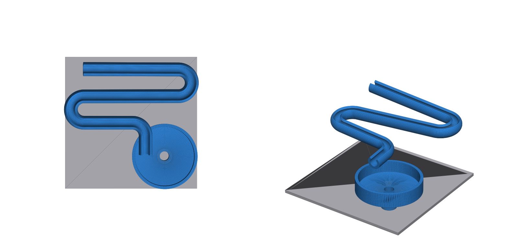

# merbl run

A 3D-printable marble race built from the parts taught in the [merbl guide](https://github.com/karnxx/merbl/blob/main/guide.md) (Half Life, week 2: CAD).

## What it is

An 8 mm marble enters the high end of an open-top track, rolls down three lanes (two 180° switchbacks), then a final turn drops it onto a funnel where it circles and falls through the hole.

## Parts

| File (`cad/`) | What | Key dimensions |
|---|---|---|
| `merbl_run_assembly.step` | **Editable CAD source**: base + track + funnel assembly | Open in Onshape, Fusion 360, FreeCAD |
| `base.step`, `track.step`, `funnel.step`, `marble.step` | **Editable CAD source**: one STEP solid per part | Same dimensions as below |
| `base.stl` | Flat base (print file) | 140 x 140 x 3 mm (limit: 150 x 150 x 4) |
| `track_assembled_position.stl` | Track swept along a 3D path | 9 mm inner / 14 mm outer diameter, 2.5 mm wall, 5° downhill, bends of 13.5 mm radius (guide minimum: above 12 mm), 369 mm long |
| `funnel.stl` | Custom track: funnel | 10 mm hole, 20 mm drop, 95° wall, 3 mm walls, 12 mm rim |
| `marble.stl` | The marble | 8 mm diameter |
| `assembly.stl` | Base + track + funnel in place | Reference only, do not print |

The `.step` files are real B-rep solids, so you can edit, measure and re-export them. The `.stl` files are for slicing. `track.step`, `track_assembled_position.stl` and `funnel.stl` keep their assembled coordinates, so slice each with its own orientation. In the assembly the funnel sits at x = 35, y = -35 on top of the base.

## Printing

- Use thin tree supports in the slicer, as the guide recommends. They hold the track up and double as its mounting.
- Before printing, check the support preview: supports may touch the outside of the track but never the inside where the marble rolls.
- After printing, roll the marble through to test.

## Rebuild or change it

`python3 scripts/generate.py` regenerates the STL files and `python3 scripts/generate_step.py` regenerates the STEP files, both from the parameters at the top of `generate.py` (slope, lane gap, funnel size...). They need `numpy`, `trimesh` and `cadquery`.

## Design checks

- Base under 150 x 150 x 4 mm: yes (140 x 140 x 3).
- Bend radius above 12 mm: yes (13.5 mm, measured from the path).
- Track clears the funnel rim wall: yes (track underside 38.8 mm, rim top 37.3 mm).
- All parts are watertight meshes, and the STEP solids are valid and do not intersect each other.

## Known limitations

- The funnel is printed standing on the base, so the marble ends up resting in the drop tube above the base. Lift the funnel to take it out.
- The STEP files are editable solids, but they have no feature tree (sketches, sweeps) like a native Onshape model would.

## Process and credits

- Design follows the merbl guide by karnxx.
- The models and generator script were produced with help from an AI assistant (Claude).
- Time log: add your Hackatime or Lapse screenshots here.
